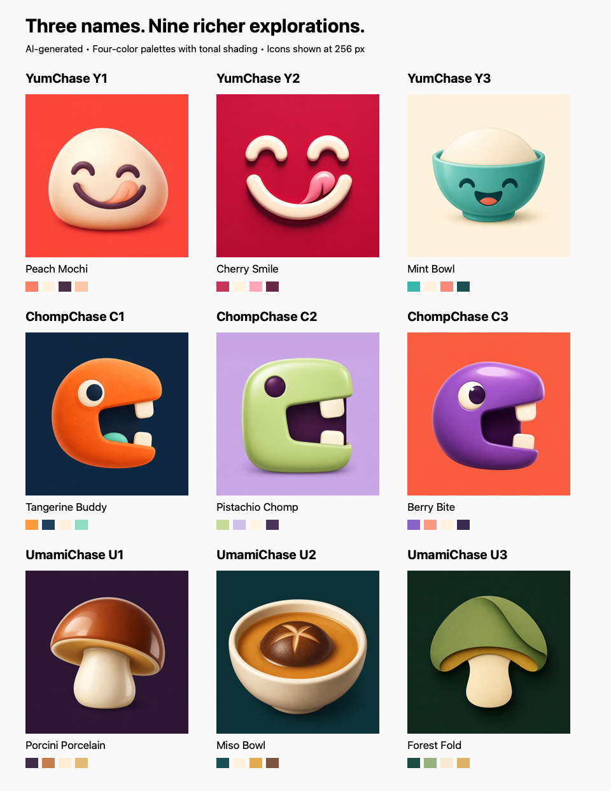
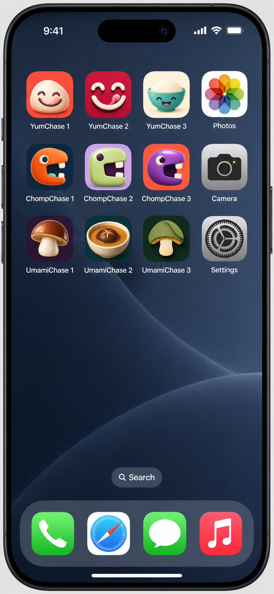
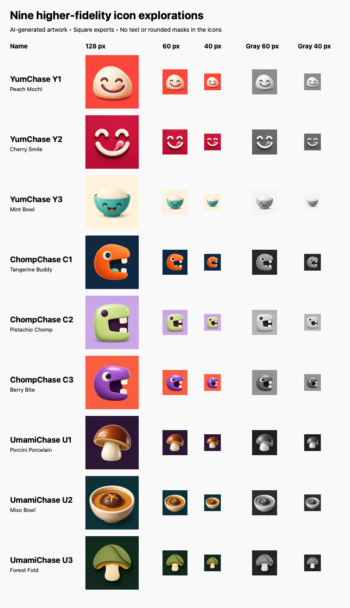

# Higher-fidelity icon explorations — round 2

Three additional concepts each for **YumChase**, **ChompChase**, and **UmamiChase**.
Generated with the built-in image-generation tool, using the first-round icons
as concept references. These are new sibling assets; the first round and the
installed app were unchanged when this exploration was generated.

**Selected for the app:** Y1 Peach Mochi, with the display name **Yum Chase**
(including the space). Its PNG is now the primary AppIcon asset. The other
concepts and the comparison mockup remain unchanged; this selection does not
itself deploy the app to a phone.

## Nine concepts



| ID | Direction | Four-color palette | 1024×1024 |
| --- | --- | --- | --- |
| YumChase Y1 | **Peach Mochi** | Coral · Cream · Plum · Peach | [PNG](yum-chase-01-peach-mochi.png) |
| YumChase Y2 | **Cherry Smile** | Cherry · Vanilla · Petal · Burgundy | [PNG](yum-chase-02-cherry-smile.png) |
| YumChase Y3 | **Mint Bowl** | Mint · Cream · Coral · Ink | [PNG](yum-chase-03-mint-bowl.png) |
| ChompChase C1 | **Tangerine Buddy** | Tangerine · Midnight · Cream · Mint | [PNG](chomp-chase-01-tangerine-buddy.png) |
| ChompChase C2 | **Pistachio Chomp** | Pistachio · Lilac · Cream · Plum | [PNG](chomp-chase-02-pistachio-chomp.png) |
| ChompChase C3 | **Berry Bite** | Berry · Coral · Cream · Plum | [PNG](chomp-chase-03-berry-bite.png) |
| UmamiChase U1 | **Porcini Porcelain** | Aubergine · Chestnut · Cream · Ochre | [PNG](umami-chase-01-porcini-porcelain.png) |
| UmamiChase U2 | **Miso Bowl** | Deep Teal · Cream · Amber · Umber | [PNG](umami-chase-02-miso-bowl.png) |
| UmamiChase U3 | **Forest Fold** | Forest · Moss · Cream · Ochre | [PNG](umami-chase-03-forest-fold.png) |

Each palette specifies four base colors; dimensional lighting, shading and edge
antialiasing produce tonal variations within those colors. The palette swatches
are prompt targets, not a claim that every generated pixel matches a hex code.

## iPhone Home Screen mockup



The three variants of each name appear together in a row, numbered 1–3 from
left to right, alongside familiar system apps for scale. This illustrative
AI-generated mockup leaves the original icons and installed app unchanged.
[Generation mode, source reference, and exact prompt](iphone-home-screen-prompt.md).

## Design direction

The request for higher fidelity and 3–4 colors intentionally expands the earlier
flat, predominantly single-color exploration. This round uses sculpted clay,
glazed enamel, ceramic volume, designer vinyl, and layered-paper depth while
keeping one focal object, chunky shapes, square full-bleed backgrounds, no text,
and no baked-in rounded corners.

- **YumChase:** Peach Mochi adds a soft character; Cherry Smile refines the original
  expression; Mint Bowl explores a more explicitly food-related mascot.
- **ChompChase:** Tangerine Buddy adds a tongue and clay texture; Pistachio Chomp
  explores softer colors and a blockier silhouette; Berry Bite explores glossy
  volume and a more expressive eye.
- **UmamiChase:** Porcini Porcelain gives the mushroom warm culinary materials;
  Miso Bowl explores savory food directly; Forest Fold uses layered graphic depth.

These are raster PNGs, not editable vector masters. The selected name and icon
are noted above; name and mark clearance are outside this visual exploration.

## Small-size review



The review renderer checks that all nine exports are 1024×1024 and presents each
at 40 and 60 pixels in both color and grayscale. Fine highlights and material
texture are secondary; the main silhouette should carry the icon at small sizes.

Visual findings: all nine remain readable as their primary face, chomper,
mushroom or bowl at 40–60 pixels. **Y1 Peach Mochi**, **C1 Tangerine Buddy**, and
**U1 Porcini Porcelain** are the strongest overall directions in this round.
**Y2 Cherry Smile** is the cleanest continuation of the original symbol.
**Y3 Mint Bowl** has lower contrast between the rice dome and background at
40 pixels, and **C2 Pistachio Chomp** has less grayscale separation between the
head and background than C1. Fine material texture disappears at small sizes as
expected. These observations are design recommendations, not user selections.

## Source prompts and reproduction

[Exact prompts, reference paths, generated originals, and palette values](prompts.json).

Rebuild both comparison sheets without changing any icon:

```sh
make icon-review ICON_DIR=docs/icon-concepts/2026-09-02-round-2
```

Original generated files remain in the tool's output directory. Workspace PNGs
are standardized 1024×1024 exports; no artistic changes were made outside the
image-generation tool.
