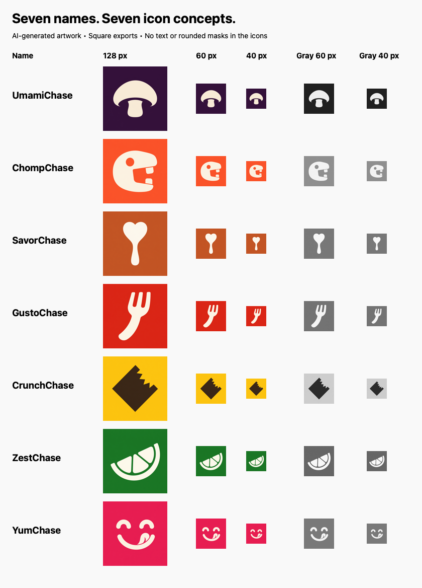

# App icon concepts — September 2, 2026

Seven separate concepts for the shortlisted product names, generated with the
built-in image-generation tool. These are AI-generated **raster PNGs with
vector-style shapes**, not editable vector masters. No app icon, bundle display
name, or deployed build has been changed.

## Compare

[Round 2: nine higher-fidelity, four-color explorations for YumChase, ChompChase,
and UmamiChase](../2026-09-02-round-2/README.md) builds on these original concepts.

Each final export is a 1024×1024 opaque square. The artwork follows the standing
direction: one bold focal point, minimal detail, one dominant color, a contrasting
neutral symbol, no text, and no baked-in rounded corners. Generator originals were
retained; the exports were downsampled without changing the artwork.

| Name | Concept | 1024×1024 PNG |
| --- | --- | --- |
| UmamiChase | Savory mushroom; deep aubergine | [Download](umami-chase.png) |
| ChompChase | Friendly chomping character; coral | [Download](chomp-chase.png) |
| SavorChase | Heart-shaped spoon; terracotta | [Download](savor-chase.png) |
| GustoChase | Sweeping fork; tomato red | [Download](gusto-chase.png) |
| CrunchChase | Angular bitten cracker; golden yellow | [Download](crunch-chase.png) |
| ZestChase | Citrus wedge; green | [Download](zest-chase.png) |
| YumChase | Delighted, lip-licking face; raspberry | [Download](yum-chase.png) |

The initial bitten-apple ChompChase concept was discarded in favor of the more
distinctive creature. These are visual brainstorms, not trademark-cleared marks.
The selected concept should be refined into editable vector artwork before
production adoption.

## Visual review

All seven retain a distinct silhouette in the 40/60-pixel color and grayscale
checks. UmamiChase and ZestChase are especially clear and food-related;
ChompChase offers the strongest character direction. SavorChase reads first as
a heart, while CrunchChase is more abstract without its name. YumChase remains
a cheerful face at 40 pixels, although its tongue detail becomes less distinct.
These are design tradeoffs to compare, not a final brand selection.

## Prompts and reproduction

[Exact final prompt set and original generated-file paths](prompts.json).
One built-in generation call was used per concept; ChompChase received a second
generation with a different subject. No external CLI/API generation was used.

Run `make icon-review` from the repository root to rebuild the labeled comparison
sheet from the saved icons. It checks dimensions and renders the same artwork at
40 and 60 pixels in color and grayscale for visual review. Labels belong only to
the comparison sheet, never to the icons.
